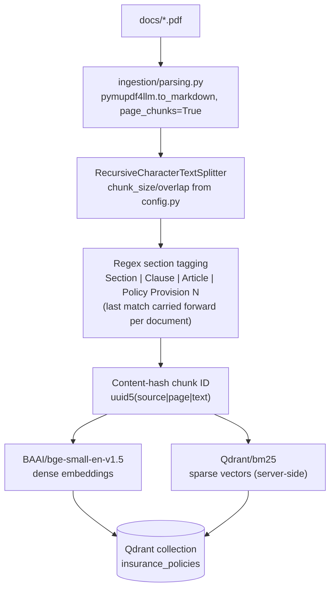
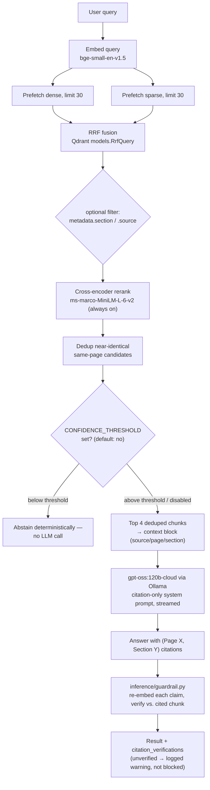

# Insurance Policy Q&A (RAG prototype)

A document-grounded Q&A system for insurance policy PDFs. Retrieves relevant
policy text via hybrid dense+sparse search in Qdrant, reranks it with a
cross-encoder, and asks an LLM to answer strictly from the retrieved context
with inline page/section citations — with no fabricated answers if the
documents don't cover the question.

This is a working prototype, split into a real package layout: `ingestion/`,
`retrieval/`, `inference/`, `eval/`, `api/`. `config.py`/`models.py`/
`exceptions.py`/`logging_config.py` are shared infrastructure; `ingest.py`
and `query.py` are thin CLI/orchestration entry points over the packages.
A real pytest-based `eval/` harness measures retrieval, citation, and
abstention quality against a hand-built golden set. A small FastAPI service
(`api/main.py`) streams query results over SSE to `frontend/`, a Vue 3 UI.
See [Roadmap](#roadmap) for what's still not built.

## Tech stack

| Layer            | Technology                                                                   |
| ---------------- | ---------------------------------------------------------------------------- |
| Package layout   | `ingestion/`, `retrieval/`, `inference/`, `eval/`, `api/`                    |
| API              | FastAPI, one SSE-streaming `GET /query` endpoint (`/ingest` not built)       |
| Frontend         | Vue 3 + TypeScript + Vite (`frontend/`), consumes `/query` via `EventSource` |
| Document parsing | `pymupdf4llm` (markdown extraction, per page)                                |
| Chunking         | `RecursiveCharacterTextSplitter` (LangChain) — sliding window, 1500/300      |
| Section tagging  | Regex heuristic, forward-carried across a document                           |
| Chunk IDs        | Content hash (`uuid5(source\|page\|text)`) — deterministic, not positional   |
| Dense embeddings | `BAAI/bge-small-en-v1.5` (sentence-transformers)                             |
| Sparse vectors   | `Qdrant/bm25`, generated server-side                                         |
| Vector store     | Qdrant — hybrid dense+sparse, RRF fusion via `RrfQuery`                      |
| Reranking        | `cross-encoder/ms-marco-MiniLM-L-6-v2`, always on                            |
| Guardrail        | Runtime citation verification (re-embed claim vs. cited chunk)               |
| Generation       | `gpt-oss:120b-cloud` via Ollama, streamed                                    |
| Data models      | Pydantic (`models.py`), typed exceptions (`exceptions.py`)                   |
| Evaluation       | pytest, RAGAS, optional Langfuse tracing                                     |

## How it works

### Ingestion (`ingest.py` → `ingestion/`)

Run manually whenever the PDFs in `docs/` change. Wipes and rebuilds the
whole Qdrant collection every time — there's no incremental/upsert path yet
(content-hash chunk IDs make that possible; the upsert-only-changed-pages
logic itself is Phase 3, not built yet).



### Query (`query.py` → `run_query()`, delegating to `retrieval/` + `inference/`)



`config.py` is the single source of truth for shared constants
(`QDRANT_URL`, `COLLECTION_NAME`, `DOCS_DIR`, `DENSE_MODEL_NAME`,
`RERANKER_MODEL_NAME`, `LLM_MODEL_NAME`, `CONFIDENCE_THRESHOLD`, plus the
named retrieval/chunking params `CHUNK_SIZE`/`CHUNK_OVERLAP`/
`PREFETCH_LIMIT`/`RRF_LIMIT`/`TOP_K_CONTEXT`/`DEDUP_SIMILARITY_THRESHOLD`).
`ingestion/` and `retrieval/` must use the same `DENSE_MODEL_NAME`, or query
embeddings silently become incompatible with stored vectors — no error,
just bad retrieval.

`query.run_query()` builds its Qdrant/embedding/reranker clients via an
injectable `retrieval.dependencies.PipelineDependencies` dataclass instead
of bare module globals (a default instance is still built once at import
time, so nothing about calling `run_query()` changed). Retrieval/LLM
failures raise typed `QdrantConnectionError`/`LLMInferenceError`
(`exceptions.py`) instead of a bare `except Exception`.

## Running the application

### Prerequisites

- [Ollama](https://ollama.com) installed, running, and signed in
  (`ollama signin`) — generation uses a cloud-hosted Ollama model
- Docker (for Qdrant)
- Python 3.12 ([uv](https://docs.astral.sh/uv/) manages the virtualenv, see
  `.venv/pyvenv.cfg`)

### Install

```bash
uv pip install -r requirements.txt
ollama pull gpt-oss:120b-cloud
```

Embeddings and reranking run locally via `sentence-transformers`
(`BAAI/bge-small-en-v1.5`, `cross-encoder/ms-marco-MiniLM-L-6-v2`),
downloaded automatically on first run.

### Start Qdrant

```bash
docker run -d -p 6333:6333 -v $(pwd)/qdrant_storage:/qdrant/storage qdrant/qdrant
```

### Ingest documents

```bash
python ingest.py                  # every *.pdf in docs/
python ingest.py --docs-dir <path>
```

This deletes and recreates the `insurance_policies` collection from every
PDF found — all documents present are ingested, not just one.

### Ask a question

```bash
python test.py
```

runs a fixed set of example queries through `diagnostic_pipeline()` and
prints retrieval diagnostics plus the streamed answer — a manual smoke test,
no assertions. To ask a single question interactively:

```python
from query import diagnostic_pipeline

diagnostic_pipeline(query="What are the key benefits of the policy?", target_source="icici-car.pdf")
```

`target_section` and `target_source` are optional filters.

### Run the API + frontend

```bash
uvicorn api.main:app --port 8000       # from the repo root
```

```bash
cd frontend && npm install && npm run dev
```

Open the printed `localhost:5173` URL. `GET /query?query=...&target_section=...&target_source=...`
streams a single `run_query()` call as Server-Sent Events — `retrieved`
(context chunks + per-stage timings, as soon as retrieval/rerank/dedup
finish) → `generation_start` → per-token `token` events → one `done` (full
result, plus an `abstained` flag) or `query_error`. The frontend renders
chunks and the trace bar progressively on `retrieved`, streams the raw
answer text on `token`, then swaps in the citation-linked, guardrail-checked
version on `done`. CORS is currently hardcoded to `localhost:5173` in
`api/main.py`. See `frontend/README.md` for the frontend side.

## Running the tests

The `eval/` suite (see `eval/README.md` for full detail) calls
`query.run_query()` programmatically against a 53-question hand-built golden
set (`eval/golden_set.jsonl`) — real Qdrant + real Ollama, no mocks. If
either service isn't reachable, the suite skips with a clear reason instead
of failing with connection-refused tracebacks.

```bash
# prerequisite: collection populated
docker run -d -p 6333:6333 -v $(pwd)/qdrant_storage:/qdrant/storage qdrant/qdrant && python ingest.py

# run everything
pytest eval/ -v

# tune sample sizes (defaults: 5 questions x 5 repeats for consistency, 12 for RAGAS)
pytest eval/ -v --consistency-n 10 --consistency-repeats 5 --ragas-n 20

# just one metric family
pytest eval/test_retrieval.py -v

# regenerate the report after any run
python -m eval.report
```

Each test module writes raw results to `eval/results/*.json`; `eval/report.py`
aggregates them into `eval/report.md`.

## Test results

Current numbers from `eval/report.md`, measured against the two included
policy PDFs (icici-car, icici-life) and the 53-question golden set
(31 answerable / 12 unanswerable / 10 ambiguous). Regenerate with
`pytest eval/ -v && python -m eval.report` after any pipeline change — these
numbers go stale otherwise.

| Metric                                                                     | Value                                                                 | What it means                                                                                                                                                                                                                                                                                                                                                 |
| -------------------------------------------------------------------------- | --------------------------------------------------------------------- | ------------------------------------------------------------------------------------------------------------------------------------------------------------------------------------------------------------------------------------------------------------------------------------------------------------------------------------------------------------- |
| Retrieval Recall@4 / Precision@4 / MRR                                     | 88.8% / 33.1% / 0.840                                                 | Of the ground-truth `(source, page)` chunks, 88.8% make it into the top candidates the reranker sees; only ~1 in 3 of the top-4 context slots is actually the ground-truth chunk (some slack is expected — a page can be relevant without being _the_ labeled ground truth); MRR 0.840 means the right chunk is usually ranked near #1 when it's found at all |
| Citation accuracy (precision / recall)                                     | 69.4% / 76.2%                                                         | Of the `(Page X, Section Y)` tokens the model outputs, 69.4% match an expected citation; of the citations we expected, 76.2% showed up                                                                                                                                                                                                                        |
| Citation verification                                                      | 89.5% (68/76)                                                         | Stricter check: re-embeds each cited claim and confirms it's actually supported by the specific chunk on the cited page — catches a plausible-but-wrong citation, not just a malformed one. Runtime guardrail (`inference/guardrail.py`) uses this same function to log a warning on unverified citations, not just the eval suite                            |
| Abstention confusion matrix (of 53)                                        | 37 correct, 12 correctly abstained, 1 hallucinated, 3 wrongly refused | Did the model answer when it should, and refuse when it shouldn't? 1 hallucination in 53 questions is the main accuracy risk surfaced by this suite                                                                                                                                                                                                           |
| Consistency (5 questions × 5 runs)                                         | 0.939 mean pairwise similarity, 72.0% citation agreement              | Same question asked repeatedly gives similar but not identical answers/citations — cloud-LLM output drifts run to run more than a single sample suggests; see note below                                                                                                                                                                                      |
| RAGAS faithfulness / answer_relevancy / context_precision / context_recall | 0.825 / 0.825 / 0.900 / 0.900                                         | Standard RAG quality metrics (n=10 sampled): faithfulness = answer is grounded in context, not invented; context_precision/recall = how clean and complete the retrieved context is                                                                                                                                                                           |

Retrieval metrics are unchanged from before the Phase 2 refactor (byte-identical
recall/precision/MRR) — the citation/abstention/consistency swings above are
normal `gpt-oss:120b-cloud` run-to-run variance, not a regression from the
package split, content-hash chunk IDs, or the new same-page dedup step (all of
which were verified against a live re-run before/after). The consistency
numbers in particular are the least stable metric here — re-run
`pytest eval/test_consistency.py -v` if you need a fresher read before relying
on a specific number.

**Confidence gate analysis** (`eval/gate_analysis.py`): a retrieval-confidence
gate (`config.CONFIDENCE_THRESHOLD`) exists and can abstain deterministically
below a cross-encoder score cutoff, but ships **disabled**. Answerable and
unanswerable questions produce overlapping top-1 cross-encoder scores on this
corpus — any threshold high enough to suppress the one observed hallucination
also wrongly refuses ~11 previously-correct answers. Full breakdown by
threshold is in `eval/report.md`.

## Known limitations

- **Section labels are a heuristic, not a structural parse** — the regex
  carries the last matched section forward across chunks/pages within a
  document, so any page without an explicit header inherits whatever section
  came before it.
- **Chunking is sliding-window, not structure-aware** — can cut a clause
  mid-sentence or separate a clause number from its content.
- **Tables are flattened** by `pymupdf4llm`'s markdown conversion —
  multi-tier premium/benefit tables lose relational structure.
- **Reranking is always on** — no latency-saving skip for high-confidence
  retrievals.
- **Citation verification is advisory, not enforced** — `inference/guardrail.py`
  runs after generation and logs a warning for an unverified citation, but
  doesn't redact or block it; the answer is already fully streamed to the
  caller by the time verification can run, so this would need a
  non-streaming or two-pass generation flow to actually gate on it.
- **Confidence gate exists but is disabled** — see Test results above.
- **Full destructive reingest** — `ingest.py` deletes and recreates the
  Qdrant collection every run. Chunk IDs are now a content hash
  (`uuid5(source|page|text)`), which makes an unchanged page's re-ingest
  idempotent at the point level, but the incremental _upsert-only-changed_
  logic itself isn't built yet (Phase 3).
- **`qdrant_storage/` is checked into git** — regenerated destructively by
  `ingest.py`, so this is repo hygiene debt, not source of truth.

## Roadmap

Condensed from `refactor.md` (full detail and rationale there):

- [x] Evaluation framework: golden set, pytest runner, retrieval/citation/
      abstention/consistency metrics, RAGAS, optional Langfuse tracing,
      generated report
- [x] Architecture refactor: split into `ingestion/`/`retrieval/`/
      `inference/`/`eval/`/`api/` packages
- [x] Runtime citation-verification guardrail (`inference/guardrail.py`,
      wired into `run_query()` — logs a warning, doesn't block; see Known
      limitations)
- [x] Content-hash chunk IDs (`uuid5(source|page|text)`) — re-ingesting an
      unchanged page is now idempotent at the point level; the incremental
      upsert-only-changed-pages _logic_ is still the Phase 3 item below
- [x] Dependency-injected clients (`retrieval.dependencies.PipelineDependencies`)
      instead of bare module-level singletons; pydantic models
      (`models.py`) instead of raw dicts passed by string key; `logging`
      instead of `print`; typed `QdrantConnectionError`/`LLMInferenceError`
      instead of bare `except Exception`; named, documented config
      constants instead of hardcoded retrieval/chunking params; same-page
      near-duplicate chunk dedup before top-k
- [ ] Replace `pymupdf4llm` with **Docling** for structure-preserving parsing + its `HybridChunker` for structure-aware chunking (fixes table
      flattening and clause fragmentation) — deliberately deferred: a heavy
      new dependency plus a full re-ingest + quality comparison, not done
      as part of the rest of the Phase 2 cleanup
- [ ] Replace the section-tagging regex with parser-derived section labels
      (blocked on the Docling migration above)
- [x] Per-stage latency instrumentation (`result["timings"]`: embed/hybrid/
      rerank/gen, in `query.run_query()`) — real numbers, not estimated;
      pulled forward to drive `frontend/`'s trace view. Token/cost tracking
      and collection versioning for zero-downtime reingest are still open.
- [ ] `ruff`/`mypy` + `pyproject.toml`, CI (lint + type-check + eval suite on
      PRs), pre-commit hooks
- [x] Small real FastAPI service — `GET /query` SSE-streaming (`api/main.py`),
      backing `frontend/`'s UI. `/ingest` gated on content-hash is not built
- [ ] Remove `qdrant_storage/` from git in favor of a documented bootstrap

## License

MIT
